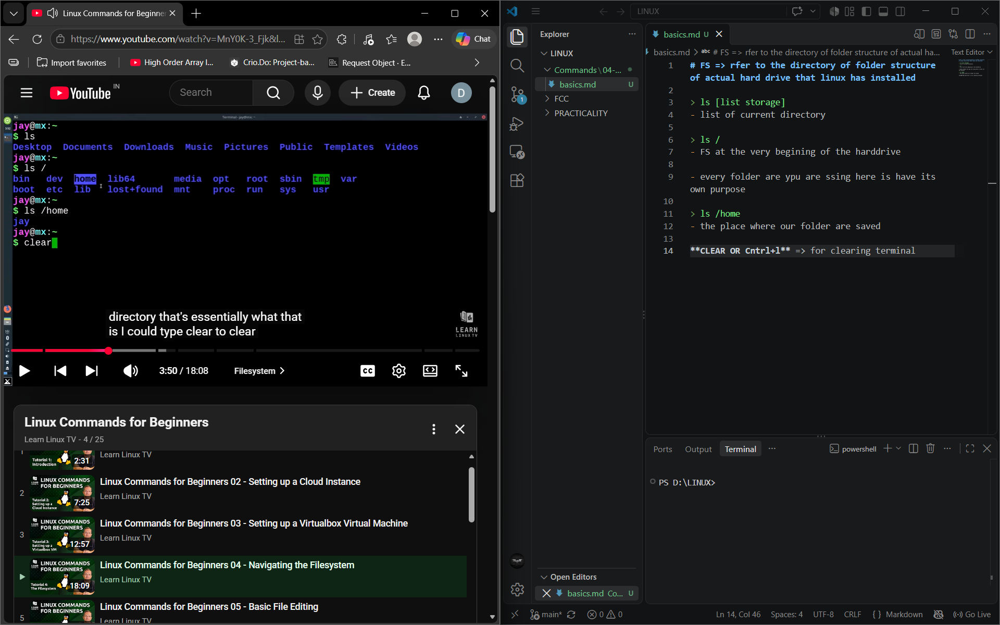
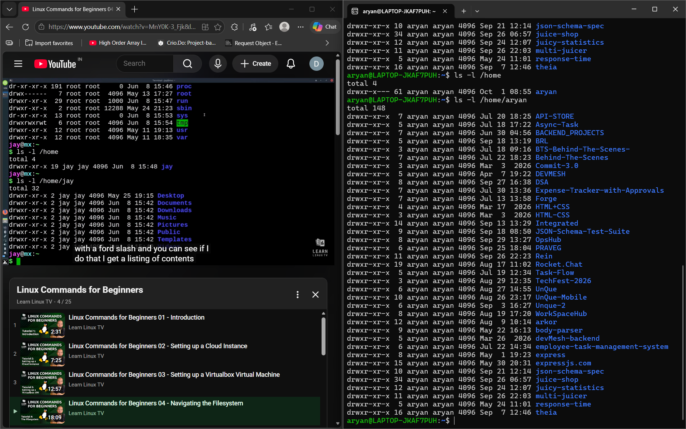
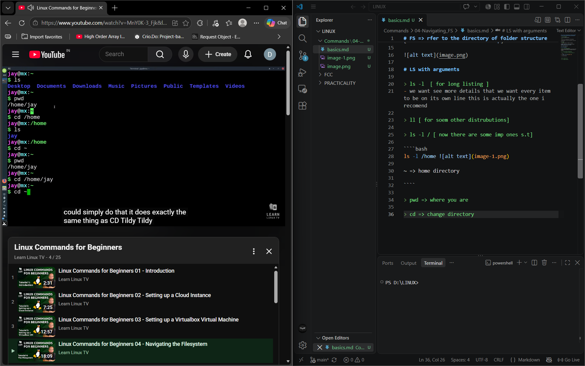
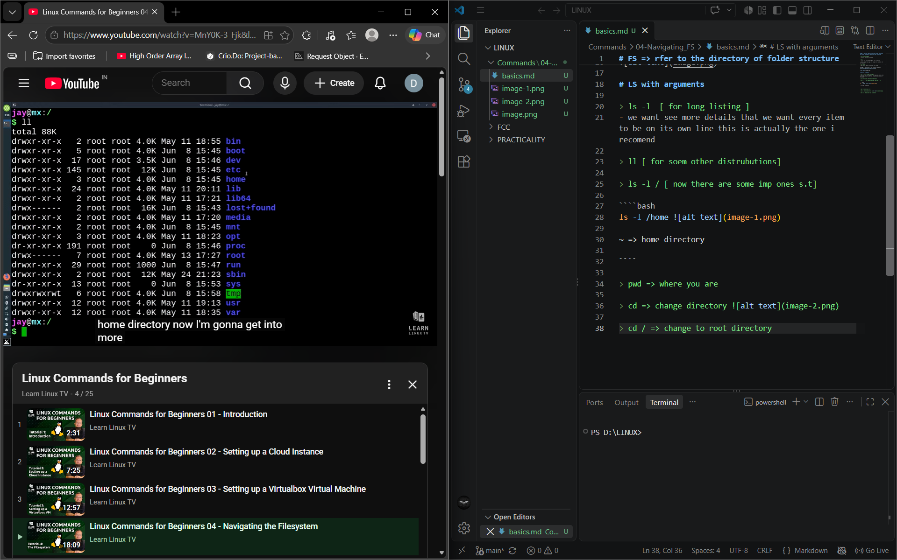

# FS => rfer to the directory of folder structure of actual hard drive that linux has installed

> ls [list storage]
- list of current directory

> ls /
- FS at the very begining of the harddrive 

- every folder are ypu are ssing here is have its own purpose 

> ls /home
- the place where our folder are saved 

**CLEAR + Cntrl+L** => for clearing terminal[kuch-ditrubition-me-shortcut-nop]



# LS with arguments 

> ls -l  [ for long listing ]
- we want see more details that we want every item to be on its own line this is actually the one i recomend 

> ll [ for soem other distrubutions]

> ls -l / [ now there are some imp ones s.t]

````bash
ls -l /home 

~ => home directory

````

> pwd => where you are 

> cd => change directory 

> cd / => change to root directory 

````bash



# Linux Directories — Quick Notes

## `/bin`

* Contains **binary/executable programs**.
* These are runnable commands and essential programs used by the system.

## `/boot`

* Contains files required to **boot the Linux system**.
* Includes boot-related configuration and files.
* ⚠️ **Do not delete this directory**, or the system may fail to boot.

## `/etc`

* Contains **system configuration files**.
* Used to configure system services, networking, users, and other system components.

### Quick Memory Trick

```text
/bin  → Programs
/boot → System startup
/etc  → Configuration
```

````

> ls -l etc

# not always

- blue: folder
- white : file
- green: programe or binary

# for confirmation see =>

if starts with 

- d: directorie
- -[hyphen]: program  
- l: link 

## root can do anything 

### SUMMARY

ls
pwd
cd /etc
ls
/etc
cd ~
ls -l /home 
pwd
ls -l 