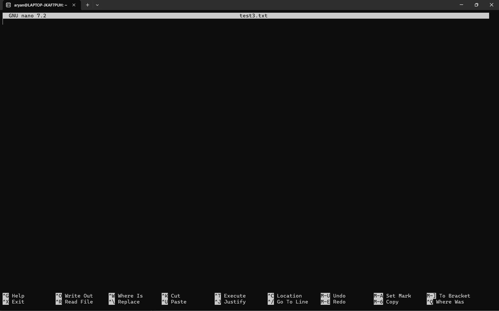

> touch testFile.txt

ls -l

- -rw-r--r--  1 aryan aryan    0 Oct  3 23:33 testfile.txt

// 0 size at the date and time its created 

> cat testFile.txt [for-reading]

but if you do this

```bash

touch testfile.txt

ls -l

time updated 

```

# text editor 

- nano [graphical-text-editor]

this text editor is not built for most linux disturbutions but it is the most easiest to use 

New Buffer => its just a text container so basically it's i am not editing a file here 

- ^ means cntl

> now we are gonna cntl O to sabe the file then name the file here testfile2.txt now do this =>

ls -l 

-rw-r--r--  1 aryan aryan   14 Oct  3 23:44 test2.txt


> now nano test3.txt



now write and ls -l

-rw-r--r--  1 aryan aryan    7 Oct  3 23:48 test3.txt

## NOW for seeing that nano is installed or not =>

so use 
- which nano 

OR

use
- which vim [one more very common editor]
