# REV =>

ls -l

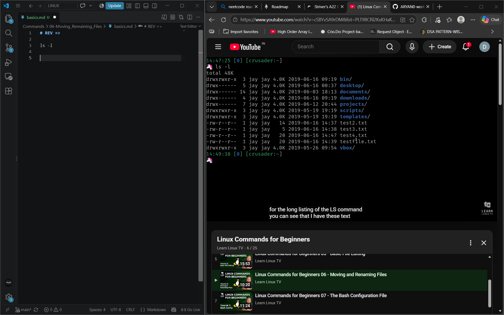

> in this video he is gonna show how he is gonna move those files around which he made earlier

cat test2.txt
learnlinux.tv

# now i am gonna copy files

cp test2.txt newfile.txt
ls -l 
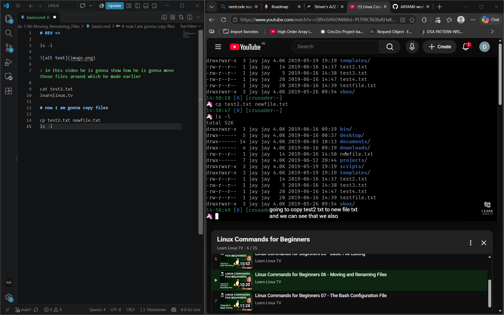

> now

cat newfile.txt
learnlinux.tv
cat test2.txt
learnlinux.tv

# now this commman tells us that the file is diffrent or not 

diff newfile.txt test2.txt
> no output 
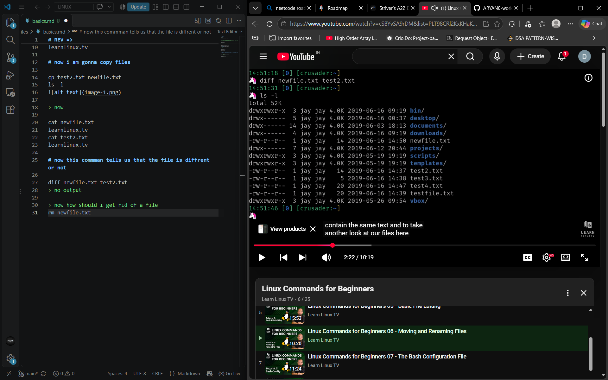

> now how should i get rid of a file
rm newfile.txt
ls -l

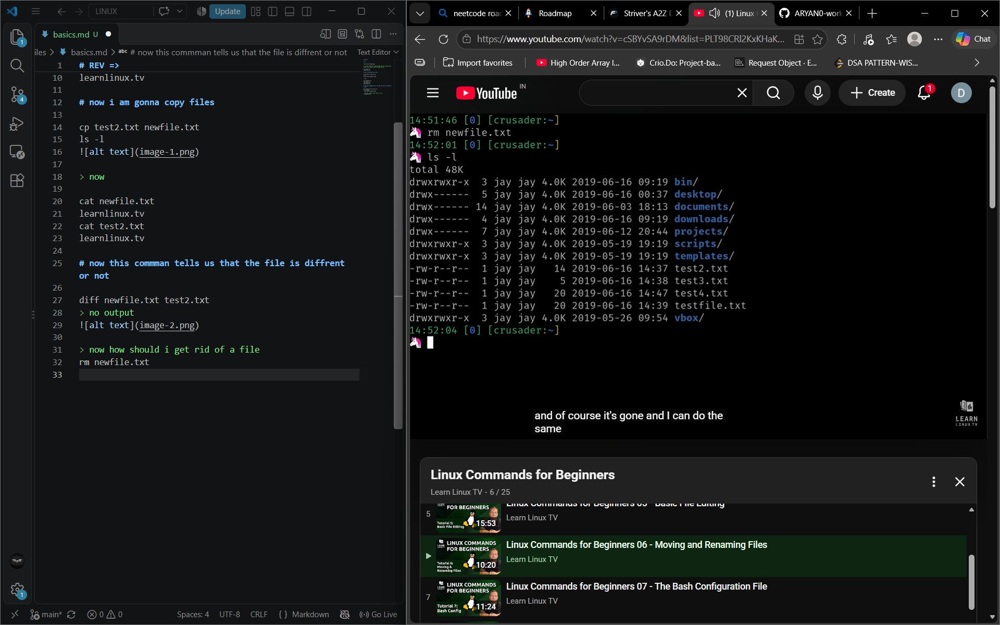

rm test2.txt
clear
ls -l

#### NOTE:-

rm -r directory

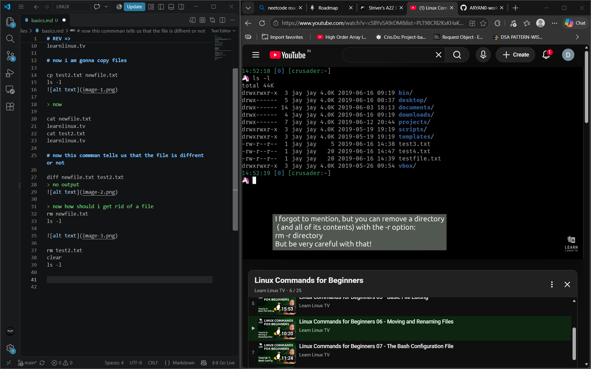

**NOTE** BE careful if you use rm command its gone no comeback :- theres no recycle bin or anything 

# BUT NOW HOW I CAN MOVE ONE FILE FROM ONE PLACE TO ANOTHER

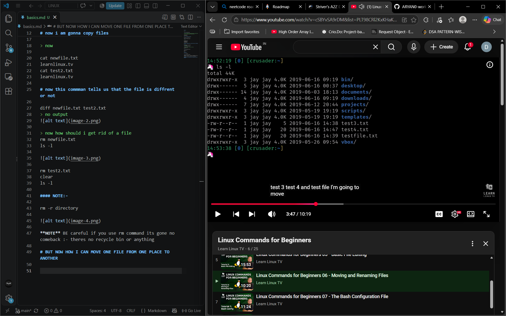

i am gonna move test3 and test4 and testfile to somewhere else

- mkdir notes

now i am gonna move them here 

mv test3.txt notes
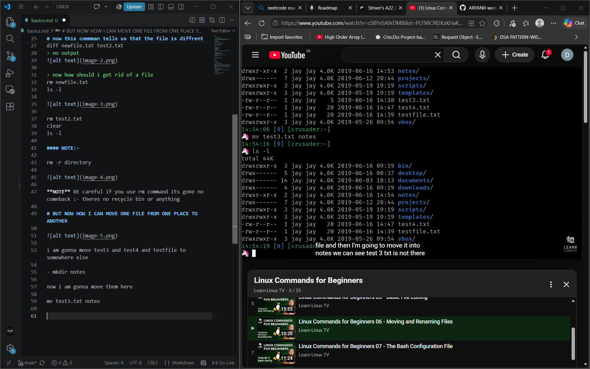

ls -l notes
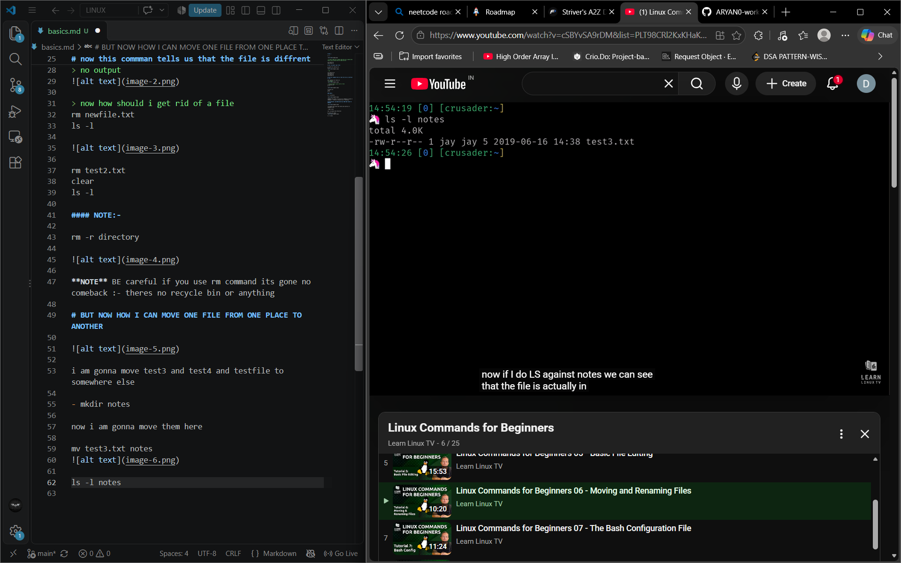

mv *.txt notes [anything-that-comes-with-star]

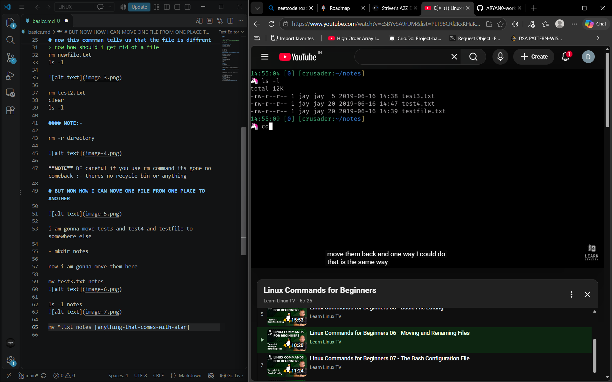

# Something interesting

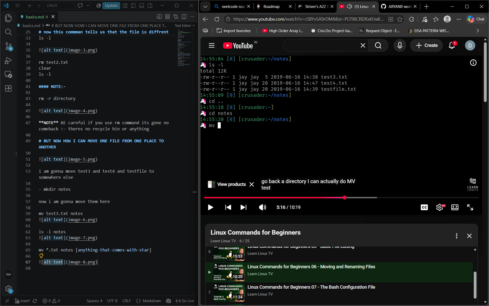

~/notes => ~: subdirectory 

mv testfile.txt .. => moving those testfiles to subdirectory

ls -l ..

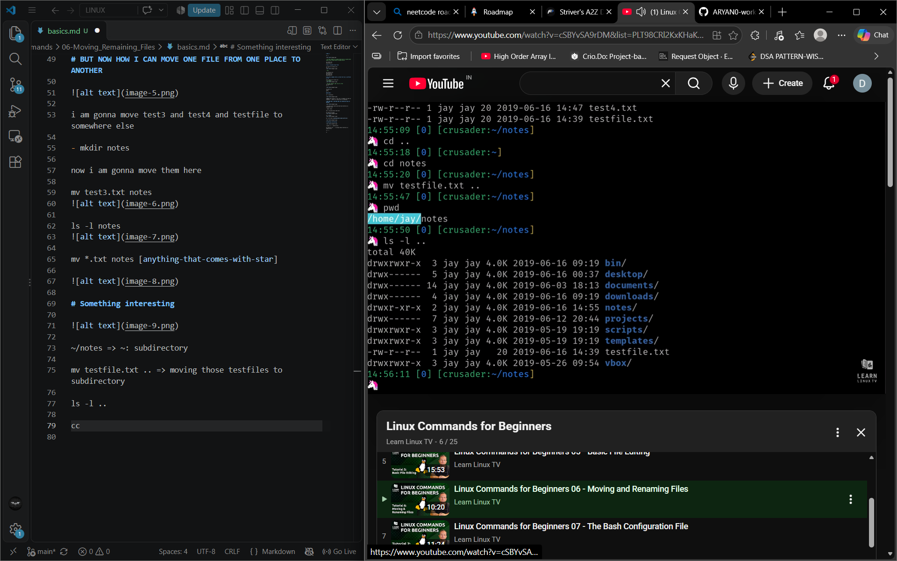

mv ../testfile.txt . [move-testfile-to-cureent-directory]

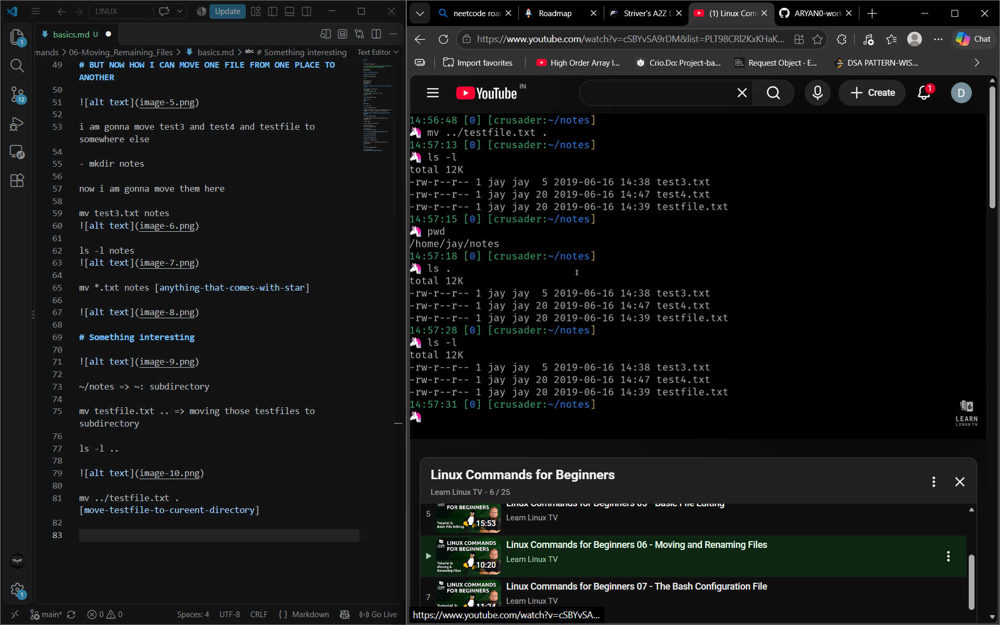

(ls . == ls -l)

# how do we rename the file
> use mv [again]

mv test3.tzt abc.txt
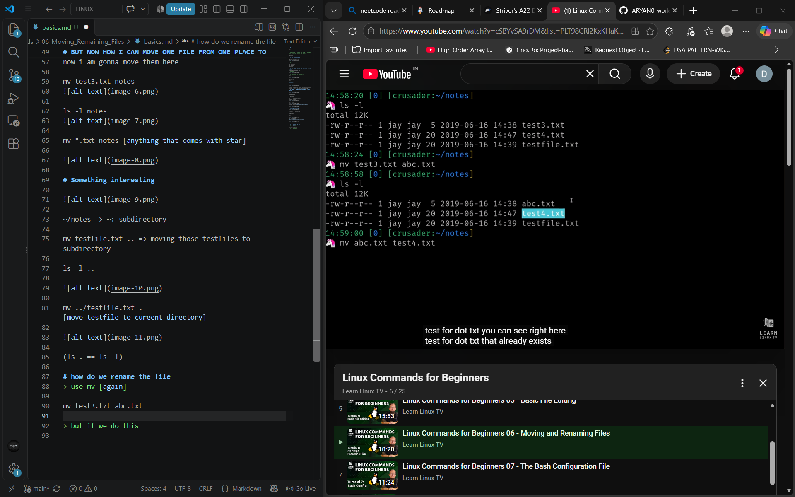

> but if we do this 
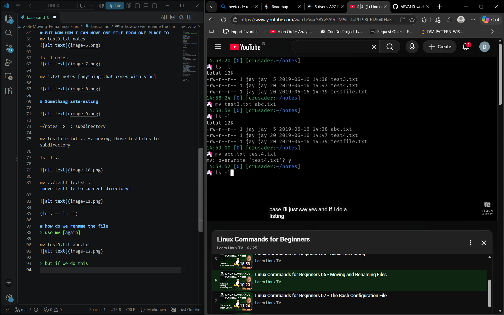

=> uske me isliye aisa aaya bcz overwrite system hai humare mai direct ho jayega

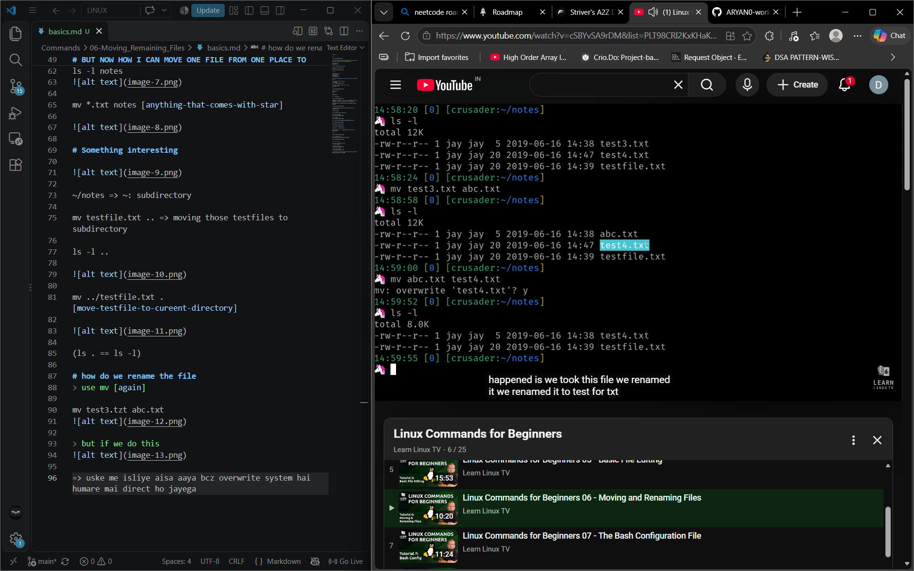