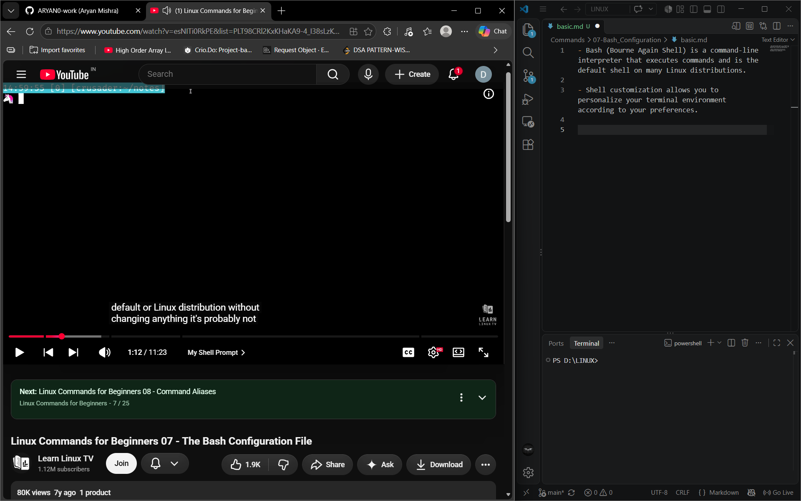
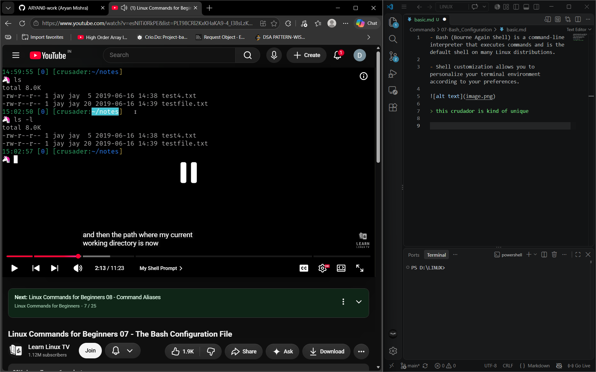
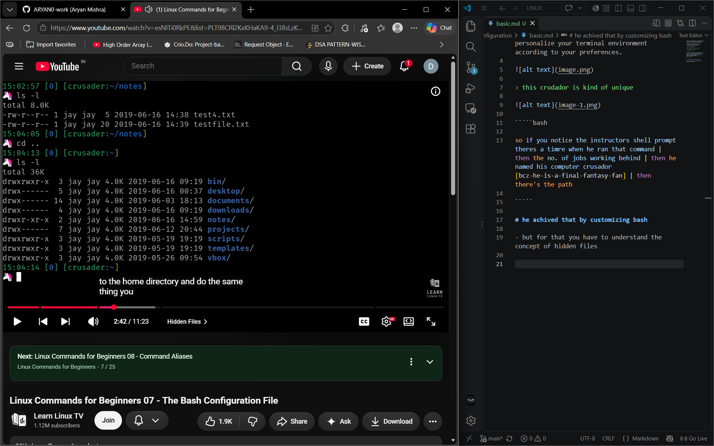
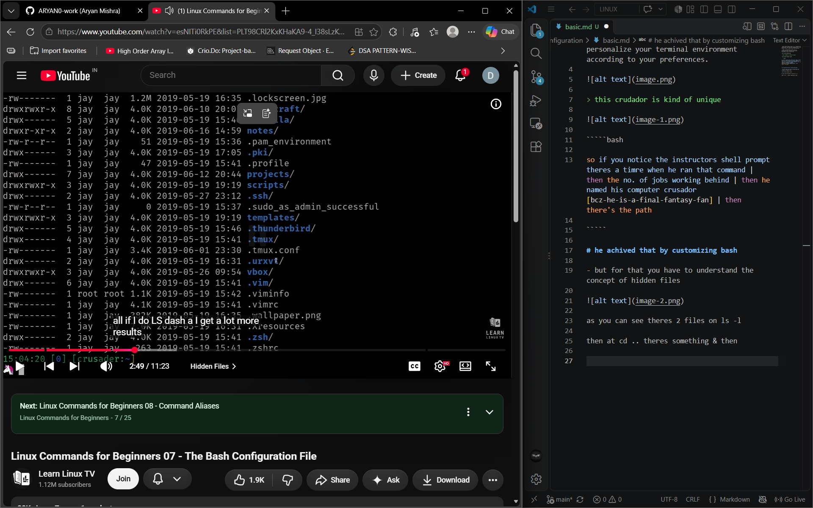
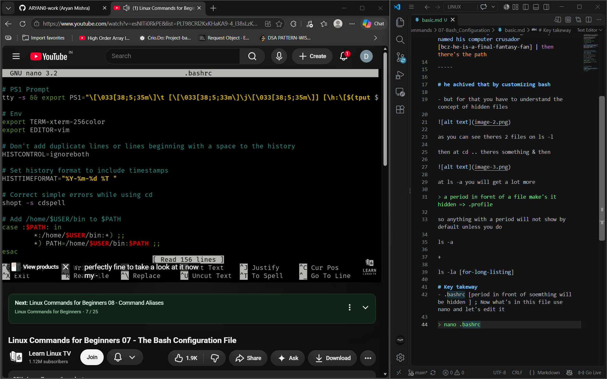
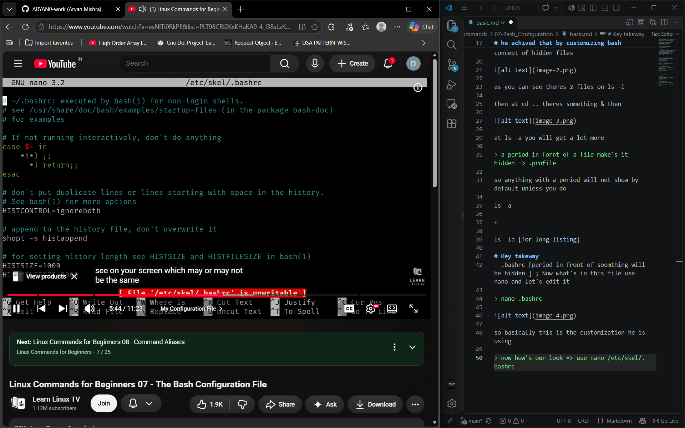
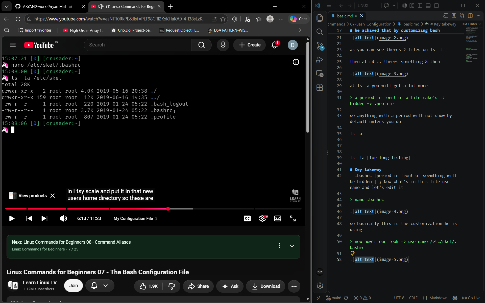
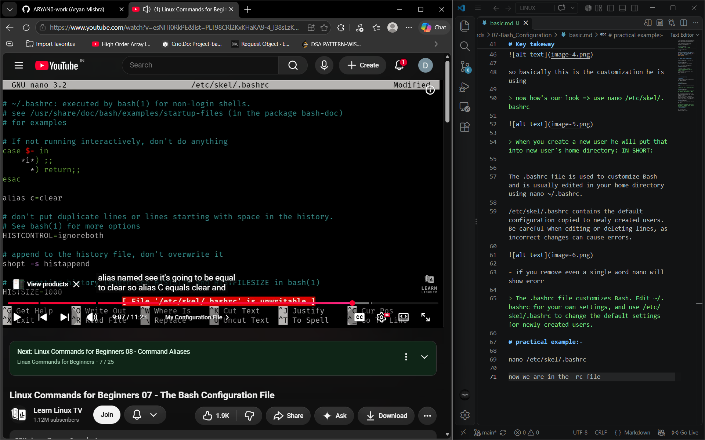

- Bash (Bourne Again Shell) is a command-line interpreter that executes commands and is the default shell on many Linux distributions.

- Shell customization allows you to personalize your terminal environment according to your preferences.



> this crudador is kind of unique



`````bash

so if you notice the instructors shell prompt theres a timre when he ran that command | then the no. of jobs working behind | then he named his computer crusador [bcz-he-is-a-final-fantasy-fan] | then there's the path

`````

# he achived that by customizing bash 

- but for that you have to understand the concept of hidden files



as you can see theres 2 files on ls -l 

then at cd .. theres something & then 



at ls -a you will get a lot more 

> a period in fornt of a file make's it hidden => .profile

so anything with a period will not show by default unless you do 

ls -a

+

ls -la [for-long-listing]

# Key takeway
- .bashrc [period in front of soemthing will be hidden ] ; Now what's in this file use nano and let's edit it 

> nano .bashrc



so basically this is the customization he is using 

> now how's our look => use nano /etc/skel/.bashrc



> when you create a new user he will put that into new user's home directory: IN SHORT:-


The .bashrc file is used to customize Bash and is usually edited in your home directory using nano ~/.bashrc.

/etc/skel/.bashrc contains the default configuration copied to newly created users. Be careful when editing or deleting lines, as incorrect changes can cause errors.



- if you remove even a single word nano will show erorr

> The .bashrc file customizes Bash. Edit ~/.bashrc for your own settings, and use /etc/skel/.bashrc to change the default settings for newly created users.

# practical example:-

nano /etc/skel/.bashrc 

now we are in the -rc file 



and c + enter clears the screen also .Same as:-

- cntrl+l
- clear

# Summary

The .bashrc file is loaded when a new interactive Bash shell starts, applying its settings automatically. Adding aliases to .bashrc makes them permanent across sessions, unlike aliases entered directly in the terminal.